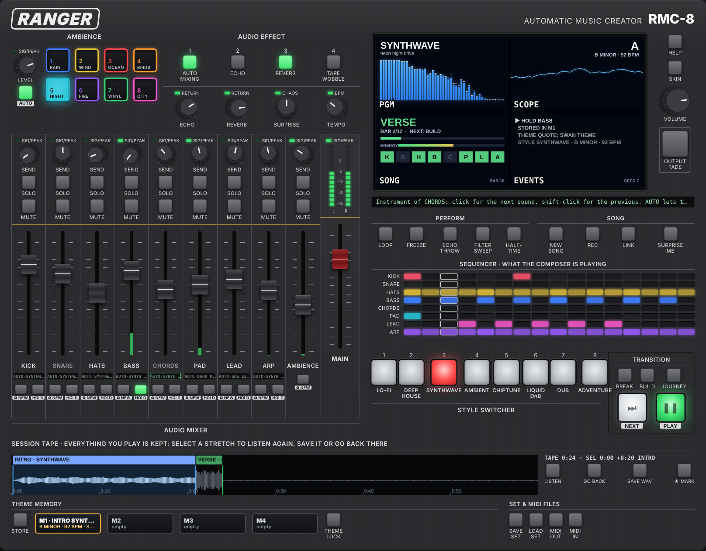
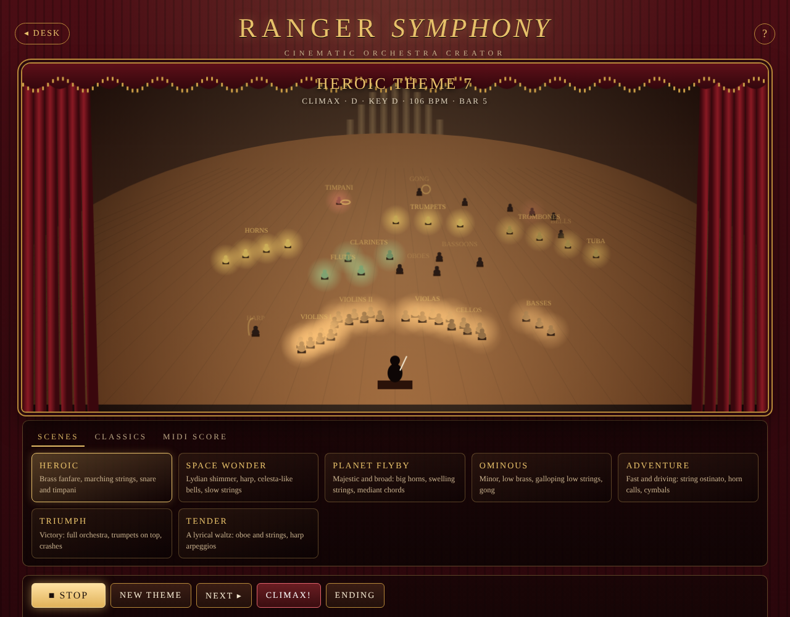

# Ranger Music Creator

An automatic music generator that looks like a mixing desk. Press **PLAY** (or
one of the eight style buttons) and it composes for as long as you let it:
intros, builds, drops and breakdowns, new melodies, key changes, echo throws
and fills, all from musical rules and a random seed. No AI model, no samples:
every sound is synthesised in the browser, so the music is royalty free and
safe to put in a game (see [LICENSES.md](LICENSES.md)).



Visual inspiration: a video/audio streaming mixer desk and the skinned
[EVG Player](https://github.com/terotests/EVGMusicPlayer) (the screen skins
are its ice, lime and ember).

## Run it

```sh
npm start          # http://127.0.0.1:8140/
npm test           # tests (Node 20+, after npm install)
```

The app has no build step and no dependencies: it is plain ES modules and Web
Audio, so any static file server works too. The GitHub Pages workflow
publishes `main`. The npm dependencies are only for the MCP server below.

## The desk

| Area | What it does |
| --- | --- |
| STYLE SWITCHER 1–9 | Lo-fi, Deep House, Synthwave, Ambient, Chiptune, Liquid DnB, Dub, Adventure, Demo Scene. A change lands on the next bar. |
| TRANSITION | **NEXT** jumps to the next section, **BREAK** / **BUILD** queue one, **JOURNEY** lets it drift between styles by itself, **PLAY** starts and pauses. |
| PERFORM | **LOOP** repeats the last 4 bars exactly (the song stops advancing), **FREEZE** loops the current section, **ECHO THROW** sends everything into a runaway dub echo, **FILTER SWEEP**, **HALF-TIME**. |
| SONG | **NEW SONG** (new seed), **REC** records from now to a WAV file, **LINK** copies a link with the seed and style, **SURPRISE ME**, **♥ LIKE** (key H) saves the beat's settings in this browser at once, **TASTE** makes new songs lean toward the liked ones (see below). |
| AUDIO EFFECT | Auto mixing (the faders ride themselves per section), echo (off by default), reverb, tape wobble; knobs for echo and reverb return, **SURPRISE** and **TEMPO**. |
| AMBIENCE | Rain, wind, ocean, birds, night, fire, vinyl, city. Off at start; **AUTO** lets each style pick. |
| AUDIO MIXER | Per part: send (echo + reverb), solo, mute, fader with meter, the instrument (click to change, AUTO lets the style choose), **♻ NEW** (rewrite that part) and **HOLD** (keep this part through section changes and surprises). |
| SESSION TAPE | Everything you play is kept (the last 10 minutes), with each section and its style marked. Click a section or drag a stretch, then **LISTEN** to hear it again, **GO BACK** to continue the song from that exact point, or **SAVE**, which opens a window in four steps: the part (sections as buttons, shift-click for a run of them, or drag the edges), the themes for the .json (A, B, intro, memory slots), the format (.wav, .json or both) and the place (disk download, or this browser's LIBRARY in IndexedDB). A saved .json is a set file that starts at that part. **★ MARK** drops a bookmark. |
| THEME MEMORY | **STORE** keeps what is playing (the loop, or the last 4 bars) in a slot. Clicking a slot recalls it as the song's base theme: chords, bassline and melody stay, and the composer only varies them. **THEME LOCK** turns that on and off. Shift-click empties a slot. |
| SET & MIDI FILES | **SAVE SET** / **LOAD SET**: the whole set as JSON (song state, mix, instruments, holds, theme memory). **MIDI OUT**: the played bars (or the selected stretch) as a multi-track MIDI file. **MIDI IN**: the melody of a MIDI file becomes a theme the composer quotes and varies. **LIBRARY**: liked songs and browser saves (play, load, download, delete), exporting all likes as JSON, and RESET TASTE. |
| Screen | Spectrum, scope, the song's structure and active layers, and a log of what the composer just did. |
| SEQUENCER | The bar that is playing, part by part. |

Keys: space play/pause, 1–9 styles, N next, L loop, F freeze, E echo throw, B break, M bookmark, R new song, H like.
Hover over any control to see what it does in the line under the screen.

## Symphony: the cinematic orchestra (`symphony.html`)

A second creator with its own page and look, a concert hall: **symphony.html**
(the **♪ SYMPHONY** button on the desk goes there, **◂ DESK** comes back). It
composes film-style orchestral music for scenes, and plays public-domain
classics, with a real sampled orchestra.



- **SCENES**: Heroic, Space Wonder, Planet Flyby, Ominous, Adventure, Triumph,
  Tender. Each writes an original 8-bar theme (with a contrasting bridge) from a
  seed and orchestrates it through a cinematic form: intro swell, the theme on
  a solo instrument, the theme in full strings with a horn counter-line, a
  bridge that builds (snare, cymbal swell, timpani roll, woodwind run), the
  climax in trumpets and horns a step higher with violins an octave above, and
  a broad ending (bVI–bVII–I and similar cadences). Then it writes the next
  theme. The themes follow the habits of large film scores (rising fifth and
  octave openings, motif and sequence, Lydian and mediant harmony); they do
  not copy any film's music.
- **CLASSICS** by composer: **Bach** (Air on the G String, Prelude in C,
  Toccata and Fugue in D minor, Sheep May Safely Graze, the Double Violin
  Concerto, Brandenburg 5, Minuet in G, Invention 1), **Vivaldi** (Spring,
  Summer presto, Autumn, Winter and its Largo from the Four Seasons),
  **Chopin** (Nocturne Op. 9/2, three preludes including the Raindrop, the
  Minute Waltz, Waltz in B minor, Fantaisie-Impromptu, Revolutionary Étude),
  **Mozart** (Eine kleine Nachtmusik), **Beethoven** (Moonlight Sonata I and III,
  Pathétique I and II, Tempest I, Appassionata finale, Symphony 7 Allegretto), **Debussy**
  (Clair de lune, Arabesque 1) and **Satie** (Gymnopédie 1). They are played
  note for note from Mutopia Project scores rendered to MIDI with LilyPond
  (`scripts/build-scores.py`, files in `scores/`), and each card offers
  **PIANO**, **STRINGS** and **ORCHESTRA** arrangements, the composer's own
  first (`src/symphony/repertoire.js`). The piano is a CC0 Steinway Model B
  from the Versilian Community Sample Library (`samples/grand/`, 6 MB, built by
  `scripts/build-piano-samples.py`); the sustain pedal in the scores is played.
  The notes are interpreted rather than typed in: accents are softened,
  phrases swell and relax, a melody grows as it climbs; romantic piano music
  gets pedal on each bass note, a singing melody over a light accompaniment
  and rubato; string and wind lines without rests are played on one bow
  (the next note starts without a new attack).
  Link: `symphony.html?work=chopin-nocturne-9-2&arr=piano`.
- Under **MORE**: The Blue Danube, Also sprach Zarathustra (the sunrise), a Mars
  build over Holst's 5/4 rhythm, the New World Largo, In the Hall of
  the Mountain King (which speeds up as it goes), Morning Mood and Swan Lake,
  arranged here (see LICENSES.md).
- **MIDI SCORE**: load a MIDI file of an orchestral score and the orchestra
  plays it. Parts are seated by track name (Violin I, Horn, Timpani…) or by
  General MIDI program; volume and expression controllers shape dynamics.
- Controls: **TEMPO**, **INTENSITY** with **AUTO SHAPE** (the form builds and
  relaxes by itself, or stays where you set it), **HALL SIZE** (studio to
  cathedral, 1.2–4.8 s) and **HALL MIX**, and a fader with mute for strings,
  woodwinds, brass, percussion, harp & bells and piano (a muted section hands its
  melody to another one). **CLIMAX!** jumps to the climax, **ENDING** plays the
  ending and stops, **NEW THEME** writes a new one.
- **SAVE WAV** renders the piece (or one full cycle of a theme) offline,
  faster than real time. **LINK** copies a link: `symphony.html?mood=flyby&seed=42`
  or `symphony.html?piece=danube`.

The orchestra is the [VS Chamber Orchestra Community Edition](https://github.com/sgossner/VSCO-2-CE)
sample library (CC0): 444 samples picked from it, trimmed, tuned (each note
is pitch-checked, and notes recorded off-pitch get a fine-tune), given
crossfaded loops so notes can be held as long as needed, and encoded as MP3
(17 MB, in `samples/vsco2/`, with `map.json`). Strings play two desks (two
recorded notes) per part for a fuller section. The hall is a generated
impulse response whose high end decays first; players further back on the
stage are darker and wetter. Code: `src/symphony/` (`composer.js` themes and
orchestration, `classics.js`, `orchestra.js` sampler and hall, `score.js` MIDI
scores, `stage.js` the hall view, `app.js` the page).

## Ragtime and Big Band (`ragtime.html`, `bigband.html`)

Two more creators built on the symphony's sampler, each with its own page
and look. The pages link to each other, to the desk and to the symphony.

**Ranger Ragtime** (1897–1925) looks like an old sheet-music cover, with a
player piano whose paper roll scrolls past the tracker bar.

- **RAGS**: Piano Rag, Cakewalk, Dixieland Stomp, Slow Drag, Novelty
  Xylophone. Each writes an original rag in the classic form: intro, first
  strain, second strain, the first again, and a trio in the subdominant, each
  strain twice, then an ending. Syncopated right hand (16th-note cells, chromatic
  lower neighbours, chord tones under the long notes) over a stride left hand
  (bass octave on the beat, chord on the off-beat, walking octaves into the
  next strain).
- **BAND**: AUTO lets the band join on the repeats: cornet (or xylophone) on
  the tune, clarinet runs, a tailgate trombone with falls, tuba on the two
  beats and drums (march, stomp, brushes or temple blocks). FULL BAND and
  SOLO PIANO fix it.
- **JOPLIN**: The Entertainer, Maple Leaf Rag, The Easy Winners, Pineapple
  Rag and Peacherine Rag, played note for note from MIDI files in `scores/`
  (made with LilyPond from the Mutopia Project's public-domain editions). The
  band arrangement is generated from the score: chords are detected from the
  notes, the band joins when a strain repeats.

**Ranger Big Band** (1935–1945) is an art-deco ballroom with the band on
three risers and a spotlight on the soloist.

- **TUNES**: Swing Bounce (32-bar AABA), Jump Blues and Kansas City Shuffle
  (12-bar blues), Moonlight Ballad, Jungle Drums (minor, tom-toms). The
  arrangement: intro, the tune with the reeds in four-part close harmony and
  brass punches (the bridge goes to the brass), improvised solo choruses for
  trumpet, clarinet, trombone or piano with section backgrounds, a shout
  chorus (often up a step) with the trumpets on top, the tune out and a tag
  ending, sometimes with a Basie-style piano button. Walking bass, ride
  cymbal with the hi-hat on 2 and 4, piano comping.
- **STANDARDS**: When the Saints Go Marching In and Maple Leaf Rag as swing.
- **SWING** sets how much the eighths swing; **SHOUT!** jumps to the shout
  chorus; **ENDING** takes it out.

The VSCO library has no saxophones, so the reeds are clarinets with a bassoon
under them. Extra samples (4.4 MB, `samples/jazz/`) are built from VSCO 2 CE
by `scripts/build-jazz-samples.py`; the hi-hat is synthesised. Code:
`src/jazz/` (`band.js` players and sample sets, `ragtime.js`, `bigband.js`,
`scores.js` Joplin MIDI files, `theory.js` jazz chords and swing, `stage.js`,
`app.js`). Links: `ragtime.html?style=stomp&seed=7`, `ragtime.html?piece=maple`,
`bigband.html?style=jump&seed=5`, `bigband.html?tune=saints`.

## Space Age and Synthwave (`spaceage.html`, `synthwave.html`)

Two more pages on the same engine, each with five styles and public-domain
classics. The composer (`src/retro/composer.js`) writes an original song (an
8-bar A theme, an 8-bar B bridge, an intro vamp) and plays it through a form:
intro, A, A, B, A, solo, B, the theme again louder and often up a key, outro
and a final chord. Layers (comping, pads, ostinatos, arpeggios, percussion)
come in as the energy rises; NEXT, the big-finish button and ENDING jump
through the form.

- **Space Age** (1955–1965): EXOTICA, THEREMIN ORBIT, BACHELOR PAD,
  COCKTAIL LOUNGE, MOON WALTZ, and Greensleeves as a space waltz. CC0
  samples for strings, flute, harp, celeste, timpani, muted brass, piano,
  marimba and Latin percussion; vibraphone, organ, theremin, flying saucers
  and birds are synthesized.
  - **APOLLO** tab (1969–70): music around Apollo 11 and Apollo 13. The
    public-domain works tied to the missions (the New World Largo, which
    Armstrong took to the Moon on tape; Also sprach Zarathustra, which opened
    the Apollo 13 TV broadcast; The Blue Danube from the 1968 film), four
    originals in the 1969 style (Countdown, Tranquility Base, Aquarius
    Lifeboat, Splashdown) and MOON SHOT 1969, which remixes these themes with
    a synthesized Moog-style lead, a 1969 beat and radio beeps.
    `spaceage.html?piece=countdown`, `spaceage.html?style=apollo&seed=5`.
  - **RADIO 1969** tab: what the radio played then, as originals in the
    manner of the time: ROCK 1969, SOUL 1969, BLUES SHUFFLE (12 bars),
    SOUL JAZZ and SUNSHINE POP, each remixing its own two tunes. Adds a
    synthesized electric guitar (clean, crunch, fuzz, palm mute), drum kit
    and tambourine. `spaceage.html?style=blues69&seed=1`.
- **Synthwave** (1980s): OUTRUN, ITALO DISCO, DARKSYNTH, DREAMWAVE, TV THEME,
  plus Grieg's In the Hall of the Mountain King (speeding up every round)
  and the opening of Bach's Toccata in D minor. Everything is synthesized:
  no samples to load.

Links: `spaceage.html?style=orbit&seed=7`, `spaceage.html?piece=greensleeves`,
`synthwave.html?style=dark&seed=3`, `synthwave.html?piece=mountain`.

## Pop Machine (`popmachine.html`)

A path from old music to modern pop. Much instrumental pop is one short riff,
repeated and transformed over a loop of four chords, and Bach's preludes work
the same way. The machine (`src/pop/composer.js`) takes a riff (a one- or
two-bar public-domain figure from `src/pop/riffs.js`, or a new motif it
writes) and a chord loop (`src/pop/progressions.js`), and plays a song: intro
(the riff alone), verse, build-up, chorus, breakdown, verse, build-up, chorus,
the chorus again in a higher key, outro.

What it does to the riff, shown on the stage as it happens: it holds the riff
while the chords change under it, moves it with the chords by scale steps
(a sequence), in exact semitones or as broken chords, makes every fourth bar
an answer phrase, plays it at half time in the breakdown, doubles it in
octaves in the chorus and lifts the last chorus by one to three semitones.

- **The path**: BAROQUE POP (1966), MOOG POP (1972), TV DRIVE (1982),
  ANTHEM (1986), EURODANCE (1994), EDM POP (2015). All synthesized.
- **Riffs**: Bach (Prelude in C, Cello Suite No. 1, Invention No. 1, Little
  Fugue, Toccata), Pachelbel, Vivaldi, Mozart (Symphony No. 40, Rondo alla
  Turca), Beethoven (Für Elise), Grieg, Rimsky-Korsakov.
- **Chord loops**: thirteen loops, each with its bass line, how it moves and
  where it is used: I–V–vi–IV, vi–IV–I–V, I–vi–IV–V, Pachelbel, IV–V–iii–vi,
  I–bVII–IV–I, vi–ii–V–I, I–iii–IV–iv, i–bVII–bVI–V, i–bVI–bIII–bVII,
  i–bVI–bVII–i, i–iv–bVII–bIII and La Folia.

Links: `popmachine.html?style=moog&seed=5&riff=elise&prog=andalusian`
(`riff` and `prog` are optional; without them the machine chooses).

The style pages share `src/stagepage.js` (transport, cards, faders, stage,
SAVE WAV); each page passes its band, composer and stage.

## TASTE: learning what you like

Everything stays in the browser; there is no server.

- **♥ LIKE** stores the song's generation parameters (seed, style, the composer's material and full snapshot, instruments) in IndexedDB (`ranger` database, `likes` store). Leaving a song within 40 s without liking it stores a mild "skip".
- `src/taste.js` turns a song's material into 36 numbers (style, tempo, scale, drum and bass density and syncopation, melody density, range and leaps, harmony colour...) and trains a small neural net (36 → 10 tanh → 1) on likes (positive), skips (negative) and a few random songs (weak negative). It retrains in a few milliseconds after each like; the weights are kept in localStorage.
- After 3 likes, **NEW SONG** and **SURPRISE ME** draw 16 candidate seeds, score them and pick one weighted by the score; one song in five is still pure chance so it keeps exploring. **TASTE** turns this off. **LIBRARY → EXPORT LIKES .JSON** downloads the data for training something bigger later.

## Control it from an AI assistant (MCP)

`mcp/server.mjs` is a local [MCP](https://modelcontextprotocol.io) server. It
serves the desk on http://127.0.0.1:8140/ and talks to the open page over a
local WebSocket, so an assistant can play, mix, loop, store themes, go back on
the tape and export WAV, MIDI and set files while you listen.

```sh
npm install
claude mcp add ranger -- node /path/to/RangerMusicCreator/mcp/server.mjs
```

For Claude Desktop, add to `claude_desktop_config.json`:

```json
{ "mcpServers": { "ranger": { "command": "node", "args": ["/path/to/RangerMusicCreator/mcp/server.mjs"] } } }
```

Then open http://127.0.0.1:8140/ and click the page once (browsers only start
audio after a click). The screen logs `MCP CONNECTED`. Files go to
`recordings/` in the repo, or to `RANGER_OUT`. Don't run `npm start` at the
same time: the MCP server uses the same port (or set `PORT`).

Tools: `get_status`, `play`, `pause`, `set_style`, `queue_section`,
`set_controls`, `set_channel`, `list_instruments`, `new_part`, `hold_part`,
`set_ambience`, `loop`, `echo_throw`, `filter_sweep`, `new_song`, `bookmark`,
`list_markers`, `go_back`, `listen`, `export_wav`, `export_midi`,
`import_midi`, `store_theme`, `recall_theme`, `list_memory`, `theme_lock`,
`save_set`, `load_set`.

The bridge only connects when the page is opened from `localhost` or
`127.0.0.1`; the GitHub Pages copy never tries. A macOS app wrapper is not
included yet.

## How it composes

- `src/styles.js`: each style is rules, not a song: tempo range, swing,
  modes, chord progressions, drum/bass/comping pattern pools, instrument
  voices, which layers come in at which energy, mix and effects.
- `src/composer.js`: plans one bar at a time and returns plain events.
  Sections follow a weighted walk (intro → verse → build → drop → break …),
  each with an energy that decides which layers play. At section boundaries
  it may change key, chords, groove, bassline, melody or tempo, or go
  half-time; inside sections it varies the hats and the melody and adds
  fills, echo throws and a silence before drops. The **SURPRISE** knob
  scales all of it. A song starts on the style's main groove, and the
  first sections stay put so there is something to come back to.
- Song form: each song has three themes, made when it starts. **A** is
  the main theme, a 4-bar melody with a chord loop picked from the style's
  loops to fit it. **B** contrasts it: other chords (from IV or vi), fewer
  and longer notes in a higher register, and a close on V so that A can
  return. The **intro theme** is A's first two bars at half speed, so the
  song opens with a hint of its main theme; breakdowns bring it back. The
  first pass runs intro → verse (A) → bridge (B) → build → drop (A) →
  break (intro) → verse → bridge → build → drop, then the weighted walk
  takes over. A repeated A gets a varied answer (A′), and long into a song
  a bridge may bring a new B. The display shows which theme is playing.
- Melodies: sometimes a phrase of a public-domain tune (`src/themes.js`,
  sources in [LICENSES.md](LICENSES.md)), played as written in its own mode
  with chords picked to fit each bar. Otherwise a generated 4-bar phrase:
  a one-bar rhythm that returns, mostly stepwise in a five-note scale for
  the calm styles, rising then falling, with a half close at bar 2 and an
  end on the tonic. A melody is heard for at least a section before it
  can change.
- Harmony (`src/theory.js`, `harmonize` and `planCadence` in the composer):
  - Tune phrases are harmonized as a whole, not bar by bar: chords must fit
    the melody and follow each other (tonic → subdominant → dominant →
    tonic). A phrase that ends on the tonic closes V–I, one that ends
    elsewhere stops on V.
  - Chord loops in major and minor sometimes get a secondary dominant
    (V7/ii, V7/V, V7/vi…), and minor keys a major V with the raised leading
    tone. A generated melody takes the chord's altered note; a quoted tune
    only gets such a chord where its notes allow it.
  - Section ends can turn around to the dominant of the next section's
    first chord (in a mode, to its own cadence chord, e.g. ♭VII–I in
    mixolydian). A key change is prepared by the new key's V7. DEMO SCENE
    keeps its abrupt jumps (`cadences: false`).
- `src/player.js`: look-ahead scheduler on the audio clock, swing and
  humanising, side-chain ducking from the kick.
- `src/engine.js`: channel strips, ping-pong echo with filtered feedback,
  generated reverb, master glue compressor, saturation, tape wobble, limiter.
- `src/instruments.js`, `src/ambient.js`: all the sounds.

The same seed and style give the same song, so a game can ship a seed
instead of an audio file:

```js
window.ranger.play({ style: 'chip', seed: 1234 });
window.ranger.next();   // jump to the next section
window.ranger.pause();
```

`Composer` has no audio dependencies and runs in Node as well.

The Demo Scene style was built from an analysis of a 90s tracker track
(tempo, drum grid, chord changes, spectrum), not from its notes: about
130 BPM, a syncopated breakbeat (kick on 1, the "a" of 1, 2-and and 3,
backbeat snare with ghost notes, off-beat hats), modal I–bVII loops,
sections that jump a major third to a new key, a long intro, 16th-note
arpeggios and a warm low-passed top end. Styles can set `keyMoves`,
`keyRate` and `introBars` for this.

## License

MIT, see [LICENSE](LICENSE). Sound sources and melodic seeds: [LICENSES.md](LICENSES.md).
