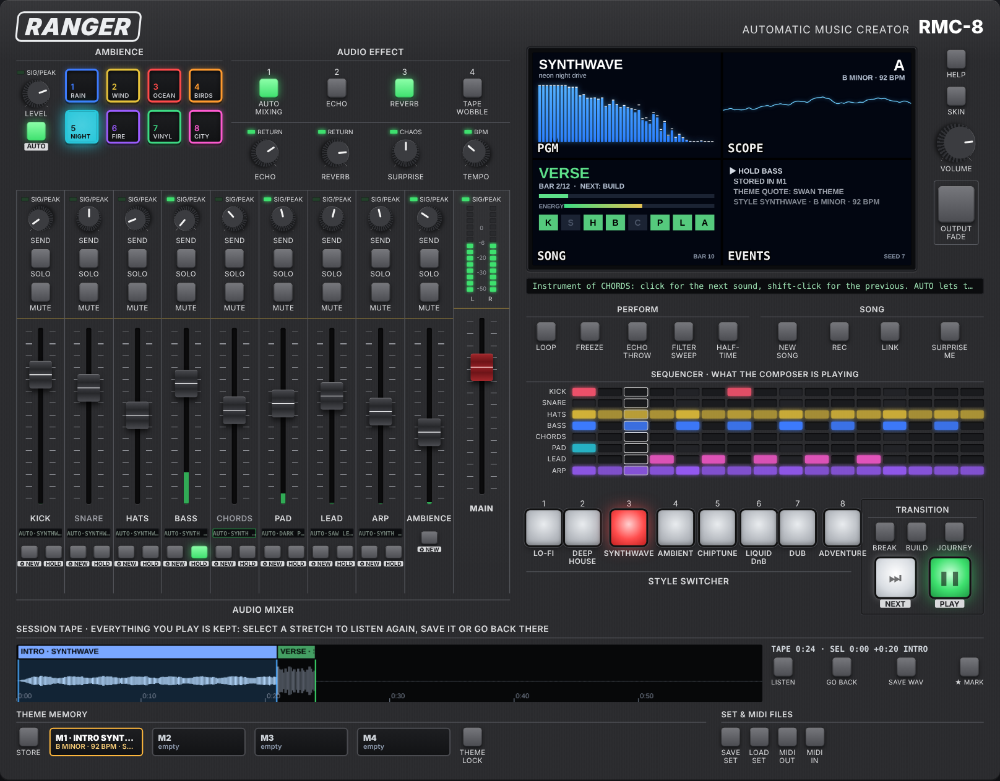

# Ranger Music Creator

An automatic music generator that looks like a mixing desk. Press **PLAY** (or
one of the eight style buttons) and it composes for as long as you let it:
intros, builds, drops and breakdowns, new melodies, key changes, echo throws
and fills, all from musical rules and a random seed. No AI model, no samples:
every sound is synthesised in the browser, so the music is royalty free and
safe to put in a game (see [LICENSES.md](LICENSES.md)).



Visual inspiration: a video/audio streaming mixer desk and the skinned
[EVG Player](https://github.com/terotests/EVGMusicPlayer) (the screen skins
are its ice, lime and ember).

## Run it

```sh
npm start          # http://127.0.0.1:8140/
npm test           # tests (Node 20+, after npm install)
```

The app has no build step and no dependencies: it is plain ES modules and Web
Audio, so any static file server works too. The GitHub Pages workflow
publishes `main`. The npm dependencies are only for the MCP server below.

## The desk

| Area | What it does |
| --- | --- |
| STYLE SWITCHER 1–8 | Lo-fi, Deep House, Synthwave, Ambient, Chiptune, Liquid DnB, Dub, Adventure. A change lands on the next bar. |
| TRANSITION | **NEXT** jumps to the next section, **BREAK** / **BUILD** queue one, **JOURNEY** lets it drift between styles by itself, **PLAY** starts and pauses. |
| PERFORM | **LOOP** repeats the last 4 bars exactly (the song stops advancing), **FREEZE** loops the current section, **ECHO THROW** sends everything into a runaway dub echo, **FILTER SWEEP**, **HALF-TIME**. |
| SONG | **NEW SONG** (new seed), **REC** records from now to a WAV file, **LINK** copies a link with the seed and style, **SURPRISE ME**. |
| AUDIO EFFECT | Auto mixing (the faders ride themselves per section), echo (off by default), reverb, tape wobble; knobs for echo and reverb return, **SURPRISE** and **TEMPO**. |
| AMBIENCE | Rain, wind, ocean, birds, night, fire, vinyl, city. Off at start; **AUTO** lets each style pick. |
| AUDIO MIXER | Per part: send (echo + reverb), solo, mute, fader with meter, the instrument (click to change, AUTO lets the style choose), **♻ NEW** (rewrite that part) and **HOLD** (keep this part through section changes and surprises). |
| SESSION TAPE | Everything you play is kept (the last 10 minutes), with each section and its style marked. Click a section or drag a stretch, then **LISTEN** to hear it again, **GO BACK** to continue the song from that exact point, or **SAVE WAV**. **★ MARK** drops a bookmark. |
| THEME MEMORY | **STORE** keeps what is playing (the loop, or the last 4 bars) in a slot. Clicking a slot recalls it as the song's base theme: chords, bassline and melody stay, and the composer only varies them. **THEME LOCK** turns that on and off. Shift-click empties a slot. |
| SET & MIDI FILES | **SAVE SET** / **LOAD SET**: the whole set as JSON (song state, mix, instruments, holds, theme memory). **MIDI OUT**: the played bars (or the selected stretch) as a multi-track MIDI file. **MIDI IN**: the melody of a MIDI file becomes a theme the composer quotes and varies. |
| Screen | Spectrum, scope, the song's structure and active layers, and a log of what the composer just did. |
| SEQUENCER | The bar that is playing, part by part. |

Keys: space play/pause, 1–8 styles, N next, L loop, F freeze, E echo throw, B break, M bookmark, R new song.
Hover over any control to see what it does in the line under the screen.

## Control it from an AI assistant (MCP)

`mcp/server.mjs` is a local [MCP](https://modelcontextprotocol.io) server. It
serves the desk on http://127.0.0.1:8140/ and talks to the open page over a
local WebSocket, so an assistant can play, mix, loop, store themes, go back on
the tape and export WAV, MIDI and set files while you listen.

```sh
npm install
claude mcp add ranger -- node /path/to/RangerMusicCreator/mcp/server.mjs
```

For Claude Desktop, add to `claude_desktop_config.json`:

```json
{ "mcpServers": { "ranger": { "command": "node", "args": ["/path/to/RangerMusicCreator/mcp/server.mjs"] } } }
```

Then open http://127.0.0.1:8140/ and click the page once (browsers only start
audio after a click). The screen logs `MCP CONNECTED`. Files go to
`recordings/` in the repo, or to `RANGER_OUT`. Don't run `npm start` at the
same time: the MCP server uses the same port (or set `PORT`).

Tools: `get_status`, `play`, `pause`, `set_style`, `queue_section`,
`set_controls`, `set_channel`, `list_instruments`, `new_part`, `hold_part`,
`set_ambience`, `loop`, `echo_throw`, `filter_sweep`, `new_song`, `bookmark`,
`list_markers`, `go_back`, `listen`, `export_wav`, `export_midi`,
`import_midi`, `store_theme`, `recall_theme`, `list_memory`, `theme_lock`,
`save_set`, `load_set`.

The bridge only connects when the page is opened from `localhost` or
`127.0.0.1`; the GitHub Pages copy never tries. A macOS app wrapper is not
included yet.

## How it composes

- `src/styles.js`: each style is rules, not a song: tempo range, swing,
  modes, chord progressions, drum/bass/comping pattern pools, instrument
  voices, which layers come in at which energy, mix and effects.
- `src/composer.js`: plans one bar at a time and returns plain events.
  Sections follow a weighted walk (intro → verse → build → drop → break …),
  each with an energy that decides which layers play. At section boundaries
  it may change key, chords, groove, bassline, melody or tempo, or go
  half-time; inside sections it varies the hats and the melody and adds
  fills, echo throws and a silence before drops. The **SURPRISE** knob
  scales all of it. A song starts on the style's main groove, and the
  first sections stay put so there is something to come back to.
- Melodies: often a phrase of a public-domain tune (`src/themes.js`,
  sources in [LICENSES.md](LICENSES.md)), played as written in its own mode
  with chords picked to fit each bar. Otherwise a generated 4-bar phrase:
  a one-bar rhythm that returns, mostly stepwise in a five-note scale for
  the calm styles, rising then falling, with a half close at bar 2 and an
  end on the tonic. A melody is heard for at least a section before it
  can change.
- `src/player.js`: look-ahead scheduler on the audio clock, swing and
  humanising, side-chain ducking from the kick.
- `src/engine.js`: channel strips, ping-pong echo with filtered feedback,
  generated reverb, master glue compressor, saturation, tape wobble, limiter.
- `src/instruments.js`, `src/ambient.js`: all the sounds.

The same seed and style give the same song, so a game can ship a seed
instead of an audio file:

```js
window.ranger.play({ style: 'chip', seed: 1234 });
window.ranger.next();   // jump to the next section
window.ranger.pause();
```

`Composer` has no audio dependencies and runs in Node as well.

## License

MIT, see [LICENSE](LICENSE). Sound sources and melodic seeds: [LICENSES.md](LICENSES.md).
